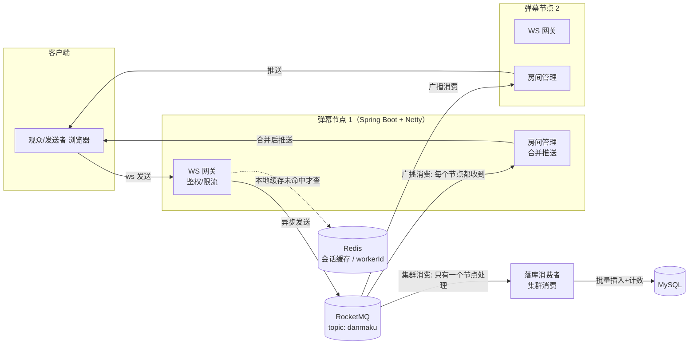

# 实时弹幕服务：设计文档与任务清单

> 这是你自己从零写的项目。EchoFrame 只用来借鉴思路，不复制它的代码。
> 分工：设计由你定，我按模块生成代码，你负责读懂、跑通、提交。每个模块你都要能讲清楚"为什么这么写"。

---

## 1. 目标与范围

**要做的**：一个可以独立部署的弹幕服务，代号 `danmaku`。

- 观众打开视频后，用 WebSocket 连进"视频房间"，实时收到别人发的弹幕。
  - WebSocket：浏览器和服务器之间一直保持的双向连接，服务器可以主动推消息。
- 登录用户可以发弹幕。发出后先推给房间里的人，再**异步**存进 MySQL。
  - 异步：先回应用户，慢的事情放到后台去做，用户不用等。
- 可以部署**多台实例**，连在不同机器上的观众也能看到彼此的弹幕。
- 能查历史弹幕（按视频和播放时间），也能查每个视频的弹幕数。

**技术栈**：Java 21、Spring Boot 3、Netty（负责 WebSocket）、RocketMQ（消息队列）、MySQL、Redis。

**不做的**（控制规模，保证你能讲清楚）：

- 不做视频上传和播放、用户注册，也不做推荐、搜索、审核后台。
- 登录只做"校验 JWT"。JWT 是一种带签名的登录凭证。签发凭证的部分用一个测试接口代替。
- 不接 ES、Canal、MinIO。

**规模目标**（在你自己的机器或一台 8 核虚拟机上验证）：

- 单个房间 1 万个连接以上。
- 入口能稳定处理 3000 条/秒以上。EchoFrame 实测是 2000，你要超过它，并能解释原因。
- 落库速度不低于入口速度，持续高峰时积压不会越堆越多。
- 宕机重启后，弹幕不丢、计数不重复。

---

## 2. 架构

### 2.1 组件和数据流



**一条弹幕的完整路径**：

1. 浏览器通过 WebSocket 发来一条弹幕。
2. 网关依次做几件事：
   - 用本地缓存校验身份，不再每条都去查 Redis。
   - 检查发送频率。
   - 生成全局唯一的弹幕 ID。
3. **异步**发到 MQ。MQ 确认收到后，给发送者回一个 `ack`（发送成功）。
4. MQ 把这条消息分给两组消费者：
   - **广播组**：每个节点都收到一份，各自推给本机上这个房间的观众。这样就解决了"只能单机广播"的问题。
   - **落库组**：所有节点里只有一个处理这条消息，批量写入 MySQL。

> 注意：和 EchoFrame 不同，这里**本机也是从 MQ 收到消息之后才推送**，不在网关里直接推给本机。好处是所有节点只走一条推送路径，逻辑简单、顺序一致。代价是多了一次 MQ 往返，大约 1–5ms。这一点是第 4 节的决策点 1。

### 2.2 消息协议（JSON 文本帧）

**连接地址**：`ws://host:9100/ws/room/{videoId}`

- 不登录也能连，但只能收弹幕。
- 登录信息放在**第一条消息**里，而不是 URL 里，避免 token 出现在访问日志中。

客户端发给服务器的消息（`op` 表示消息类型）：

```json
{"op":"auth","token":"<jwt>"}
{"op":"send","clientSeq":17,"content":"前方高能","color":"#ffffff","playbackTime":12.5}
{"op":"ping"}
```

- `clientSeq` 是客户端自己递增的编号，服务器回 ack 时原样带回，客户端靠它把回复和自己发的那条对上。

服务器发给客户端的消息：

```json
{"op":"authOk","userId":"123"}
{"op":"ack","clientSeq":17,"id":"7290000000000000001"}
{"op":"error","clientSeq":17,"code":"BUSY","msg":"服务繁忙，请稍后重试"}
{"op":"batch","items":[{"id":"...","userId":"...","content":"...","color":"#fff","playbackTime":12.5,"sentAt":1732080000000}]}
{"op":"online","count":1024}
{"op":"pong"}
```

错误码都放在 `code` 字段里：

| code | 含义 |
|---|---|
| `UNAUTHORIZED` | 没登录或登录过期 |
| `RATE_LIMITED` | 这个用户发太快了 |
| `BUSY` | 服务器过载，**连接不会被断开** |
| `INVALID` | 消息格式错误 |
| `VIDEO_CLOSED` | 视频不存在或已关闭弹幕 |

`id` 用字符串传，因为 JS 的数字最多只能精确表示 2^53，64 位 ID 用数字传会丢精度。

### 2.3 核心表

```sql
-- 弹幕本体。主键用服务端生成的雪花 ID，它同时就是幂等键：重复插入会被主键挡掉
CREATE TABLE danmaku (
  id            BIGINT PRIMARY KEY,
  video_id      BIGINT NOT NULL,
  user_id       BIGINT NOT NULL,
  content       VARCHAR(255) NOT NULL,
  color         CHAR(7) NOT NULL DEFAULT '#ffffff',
  playback_time DOUBLE NOT NULL,          -- 弹幕出现在视频第几秒
  created_at    DATETIME(3) NOT NULL,
  KEY idx_video_play (video_id, playback_time)
);

-- 每个视频的弹幕计数（单独一张表，避免频繁锁视频主表）
CREATE TABLE video_danmaku_stat (
  video_id BIGINT PRIMARY KEY,
  count    BIGINT NOT NULL DEFAULT 0,
  updated_at DATETIME(3) NOT NULL
);

-- 视频的最小信息：本服务只关心"能不能发弹幕"
CREATE TABLE video (
  id     BIGINT PRIMARY KEY,
  status TINYINT NOT NULL   -- 1=开放弹幕 0=关闭
);
```

**幂等怎么做**（幂等：同一条消息处理多少次，结果都和处理一次一样）：

- 插入弹幕时用 `INSERT IGNORE`，主键冲突的就跳过。
- 计数只加"这次**真正插进去**的行数"。JDBC 批量插入会返回每一行影响了几行。
- 插入和计数放在同一个事务里。

这样做不需要先 `SELECT ... FOR UPDATE` 锁视频行，也就从根本上避开了"热点行锁"的问题。

---

## 3. 从 EchoFrame 压测里学到的，以及改进方案

| # | EchoFrame 实测或读代码发现的问题 | 我们的改法 |
|---|---|---|
| 1 | **只能单机广播**：房间只存在一个进程的内存里，MQ 只用来落库。部署多台时，连在不同机器的观众看不到彼此的弹幕 | 给每个节点建一个**广播消费组**（RocketMQ BROADCASTING 模式，每个节点都收到全部消息），收到后推给本机房间。备选方案是 Redis Pub/Sub，见决策点 1 |
| 2 | **雪花 ID 的机器号写死成 1**：多台实例会生成重复 ID，消费端会把它当成冲突，弹幕最后进死信队列丢掉 | workerId 每个实例单独分配。启动时向 Redis 抢一个编号，`SET worker:{n} instanceId NX EX 60`，然后定时续期。也可以用环境变量手动配置，见决策点 2 |
| 3 | **入口卡在同步 I/O 上**：每条弹幕都要同步查 Redis、查 MySQL、同步发 MQ，只有 4 个线程，CPU 只用了 1.8 核就到顶，大约 2000 条/秒 | ① 鉴权只在连接建立时做一次（`auth` 消息），结果存在连接上；② 视频状态放进本地缓存（Caffeine，过期时间 30 秒）；③ MQ 用 `asyncSend`，在回调里回 ack。这样 Netty 的 IO 线程不会被阻塞，业务线程池也基本不会排队 |
| 4 | **过载就断开连接**：队列满了会抛异常，接着连接被关闭，客户端也不知道发生了什么 | 加两层保护：① 给每个用户做令牌桶限流（例如每秒 5 条），超出就回 `RATE_LIMITED`；② 全局限制同时在途的 MQ 请求数量（例如 2000 个），满了就回 `BUSY`。**两种情况都只回错误，不断开连接** |
| 5 | **落库太慢**：大约 630 行/秒，比入口的 2000 条/秒低很多，高峰时积压越堆越多。慢在拉取节奏（每 200ms 拉 50 条）和逐个视频加锁 | ① 加大拉取批次，缩短拉取间隔，多开几个队列和消费线程；② 每批用一条多行 `INSERT IGNORE` 写入；③ 计数按视频汇总后，用一条 `INSERT ... ON DUPLICATE KEY UPDATE count=count+?` 更新；④ 去掉 `FOR UPDATE`。目标是落库速度不低于入口速度 |
| 6 | **超大房间推送变慢**：4 万连接时 P99 退化到秒级。原因是一个调度线程持有房间锁，一次写完所有连接 | ① 房间里的连接**按 EventLoop 分片**（EventLoop 是 Netty 里负责一组连接读写的线程），每个分片在自己的线程上推送，可以并行写、不用加锁；② 合并窗口可以自适应：空闲时立即推送，繁忙时攒一批再推（第 4 节决策点 5）；③ 对写不动的慢连接（`isWritable()==false`）直接丢掉这次推送，不要让它拖慢整个房间 |
| 7 | 合并推送确实有用（EchoFrame 实测写次数降低 98%，CPU 降低 85%），但低流量时要白等 100ms | 保留"窗口 + 条数上限"的合并机制，并加上"上一批推完后，如果一段时间没新弹幕，下一条立即推送"的规则 |

---

## 4. 需要你做的决策（每个二选一，我给出建议）

> 已定（2026-11-20）：1A RocketMQ 广播，2B Redis 抢 workerId，3A 数据库批量计数，4A MQ 确认后 ack，5A 固定窗口。

**决策点 1：怎么把弹幕广播给所有节点**

- A. **RocketMQ 广播消费**：本来就要用 MQ，不需要多加组件；消息可靠，节点重启后还能从断点继续读。缺点是延迟稍高（几毫秒），而且广播模式的消费进度存在每台机器本地。
- B. **Redis Pub/Sub**：延迟最低，写起来最简单。缺点是节点断开期间的消息会直接丢失（Pub/Sub 不存消息），Redis 还多承担一份压力。
- **建议选 A。** 弹幕允许偶尔延迟几毫秒，但"MQ 一条消息同时供两个消费组使用（广播推送和集群落库）"本身就是很好的面试话题。B 可以作为对比方案写进文档。

**决策点 2：雪花 workerId 怎么分配**

- A. **环境变量手动配置**（`WORKER_ID=3`）：最简单，但多台部署时人工配置容易配重。
- B. **启动时向 Redis 抢一个编号并定时续期**：自动分配，扩容时不用管。但要处理"续期失败了怎么办"，比如停止生成 ID 并拒绝发送。
- **建议选 B**，同时保留 A 作为覆盖手段（配置了环境变量就用环境变量的值）。

**决策点 3：弹幕计数怎么更新**

- A. **落库时在数据库里按批加**：和插入在同一个事务里，数字一定准确，实现也简单。
- B. **先在 Redis 里 INCR，定时同步到数据库**：读取最快，但 Redis 和数据库之间会有短暂的不一致，宕机时还可能少算。
- **建议选 A。** 第 3 节已经把计数改成按批汇总，数据库压力不大。如果查询量大，再在前面加一层只读缓存。

**决策点 4：发送成功的确认（ack）在什么时候回**

- A. **MQ 确认收到之后再回 ack**：用户看到"发送成功"，就保证这条弹幕不会丢。
- B. **收到就立刻回 ack，再在后台发 MQ**：感觉更快，但 MQ 发送失败时用户会以为发出去了。
- **建议选 A。** 改成异步发送以后，A 的额外延迟只有 1–3ms。

**决策点 5：合并窗口用固定值还是自适应**

- A. **固定窗口**（例如 100ms 或攒满 50 条）：简单，行为可预测。
- B. **自适应窗口**（空闲时立即推，繁忙时最多等 50–100ms）：低流量时延迟更低，但要多写一些逻辑和测试。
- **建议先做 A，M6 压测之后再升级到 B**，并拿前后两组数据做对比。

---

## 5. 任务清单（按里程碑做，每个里程碑都要能跑、能测、能提交）

### M0 脚手架（第 1–2 天）

- **要做**：
  - Maven 多模块（或单模块分包）项目。
  - 准备 `docker-compose.yml`，或本地安装 MySQL、Redis、RocketMQ。
  - 建表脚本（Flyway）。Flyway 是数据库版本管理工具，启动时会自动执行建表 SQL。
  - 健康检查接口。
  - GitHub Actions 跑 `mvn test`。
- **验收标准**：一条命令拉起依赖，`mvn spring-boot:run` 能启动；`/health` 返回 OK；CI 是绿的。
- **面试题**：
  - 你为什么把这些组件拆开或放在一起部署？
  - Flyway 解决了什么问题？

### M1 WebSocket 网关与房间（第 3–5 天）

- **要做**：
  - Netty 服务端：处理 HTTP 升级到 WebSocket，解析路径里的 videoId。
  - 维护房间和连接的关系；断线时自动离开房间。
  - 心跳：空闲 60 秒发 ping，超时就断开。
  - 在线人数推送：合并后每秒最多推一次。
- **验收标准**：浏览器或 `websocat` 能连上；开两个窗口进同一个房间，能互相收到消息（这一步先在本机直接推）；断开后在线人数正确减少。
- **面试题**：
  - Netty 的 boss 线程组和 worker 线程组分别负责什么？
  - 为什么不能在 IO 线程上做阻塞调用？
  - WebSocket 的握手过程是怎样的？

### M2 鉴权、校验、ID 生成、限流（第 6–8 天）

- **要做**：
  - 处理 `auth` 消息：校验 JWT，结果保存在连接上。
  - 视频状态放进 Caffeine 本地缓存。
  - 雪花 ID：workerId 用 Redis 分配并续期（决策点 2）。
  - 用户级令牌桶限流，超限回 `RATE_LIMITED`。
  - 内容校验：长度、颜色、播放时间。
- **验收标准**：
  - 单元测试覆盖：过期 token、超速发送、非法内容。
  - 同时启动两个实例，拿到的 workerId 不同。
  - 杀掉一个实例，60 秒后它的编号可以被别的实例复用。
- **面试题**：
  - 雪花 ID 由哪几部分组成？时钟回拨了怎么办？
  - 令牌桶和固定窗口限流有什么区别？
  - 为什么鉴权只在连接建立时做一次，用户退出登录后怎么让连接失效？

### M3 MQ 发送与跨节点广播（第 9–11 天）

- **要做**：
  - `asyncSend` 发到 topic `danmaku`，在回调里回 `ack` 或 `BUSY`。
  - 用信号量（Semaphore）限制在途请求数量，满了直接回 `BUSY`，不排队、不断开。
  - 广播消费组：收到消息后推给本机房间（决策点 1）。
- **验收标准**：
  - 启动两个节点，A 节点的观众能收到 B 节点用户发的弹幕。
  - MQ 停掉时发送者收到错误，而不是卡死。
  - 压到过载时客户端收到 `BUSY`，**连接数不减少**。
- **面试题**：
  - RocketMQ 的集群消费和广播消费有什么区别？各自的消费进度存在哪里？
  - 异步发送失败了怎么处理？
  - 背压是什么？为什么"回错误"比"断开连接"更好？（背压：下游处理不过来时，让上游慢下来或者拒绝新请求。）

### M4 合并推送与大房间优化（第 12–14 天）

- **要做**：
  - 每个房间按"窗口 + 条数上限 + 字节上限"合并推送。
  - 房间里的连接按 EventLoop 分片，每个分片在自己的线程上推送，不用加锁。
  - 遇到不可写的慢连接就跳过这次推送并计数。
  - 合并参数做成配置项，支持关闭合并，方便做对比实验。
- **验收标准**：
  - 单元测试覆盖：攒满 50 条立即推送、窗口到期推送、超大消息被拒绝。
  - 关闭合并时，`metrics` 显示的写次数约等于"消息数 × 观众数"；开启合并后显著下降。
- **面试题**：
  - 合并推送是用什么换什么？延迟和吞吐之间怎么取舍？
  - 为什么按 EventLoop 分片就不用加锁了？
  - 慢客户端会拖垮服务器吗？怎么防？

### M5 异步落库与幂等（第 15–17 天）

- **要做**：
  - 落库消费组（集群消费）：调大批次和拉取频率。
  - 每批一条多行 `INSERT IGNORE`，计数按视频汇总后一次更新，两者在同一个事务里（决策点 3）。
  - 处理失败就让 MQ 重试；重试多次仍失败的消息进死信队列。
  - 历史查询接口：`GET /videos/{id}/danmaku?from=&to=`。
- **验收标准**：
  - 同一批消息投递 3 次，数据库行数 = 去重后的 ID 数 = 计数。
  - 压测时 `kill -9` 再重启，结果同样成立。
  - 积压 3 万条时，清空速度要超过你在 M6 测出的入口速度。
- **面试题**：
  - 你是怎么做到幂等的？为什么不需要 `SELECT ... FOR UPDATE`？
  - 消息至少投递一次（at-least-once）意味着什么？
  - 落库比入口慢会发生什么，你是怎么发现、怎么解决的？

### M6 压测与报告（第 18–21 天）

- **要做**：
  - 复用 EchoFrame 那套测试方法（这是思路，不是代码），自己写压测客户端（Go 或 Java）。
  - 测四个场景：单房间连接容量、最大吞吐、合并推送开和关的对比、一致性（重复投递和 kill -9）。
  - 再加一个**双节点**场景：两台实例各自连一半观众。
  - 每组至少跑两次，记录机器配置。
- **验收标准**：产出一份 `report.md`，所有数字都能追溯到原始结果文件；写出 2–3 条简历句子，只用实测数字，并注明测试环境。
- **面试题**：
  - 你的瓶颈在哪里？你是怎么证明的（用了哪些指标）？
  - 同机压测会有什么偏差？
  - 如果流量再涨 10 倍，你下一步改什么？

---

## 6. 时间安排（大约 3 周，每天 3–4 小时；时间紧可以压缩到 2 周，把 M4 的分片和 M6 的双节点场景放到最后选做）

| 周 | 里程碑 | 周末检查点 |
|---|---|---|
| 第 1 周 | M0 脚手架、M1 网关和房间、M2 前半（鉴权和 ID） | 本机能连接、能收发，单测是绿的 |
| 第 2 周 | M2 后半（限流）、M3 MQ 和跨节点广播、M4 合并推送 | 双节点能互通，过载时回 BUSY |
| 第 3 周 | M5 异步落库和幂等、M6 压测和报告 | 一致性测试通过，报告和简历句子写好 |

**协作方式**：

- 每个里程碑开始前，你先确认这一步涉及的决策点。
- 我按模块生成代码和单测；你读完能用自己的话讲一遍，跑通后再提交。
- 每个里程碑结束，我按上面的面试题问你一轮。
